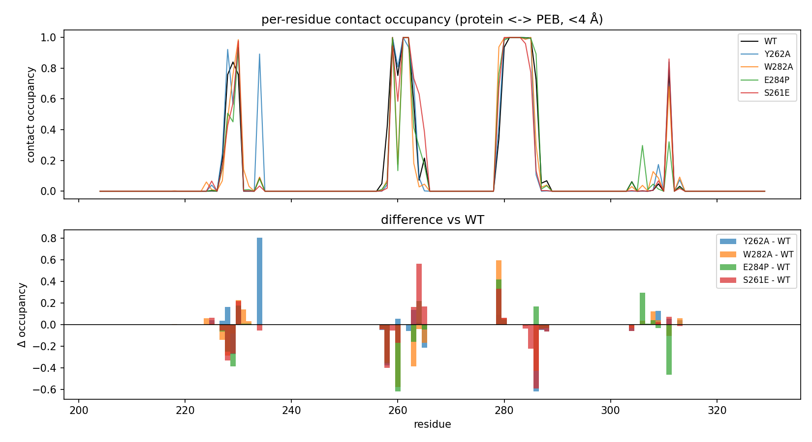
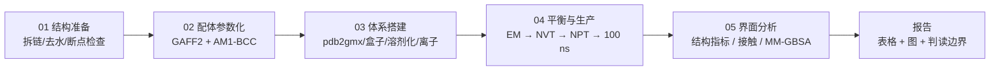
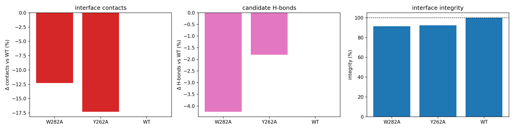
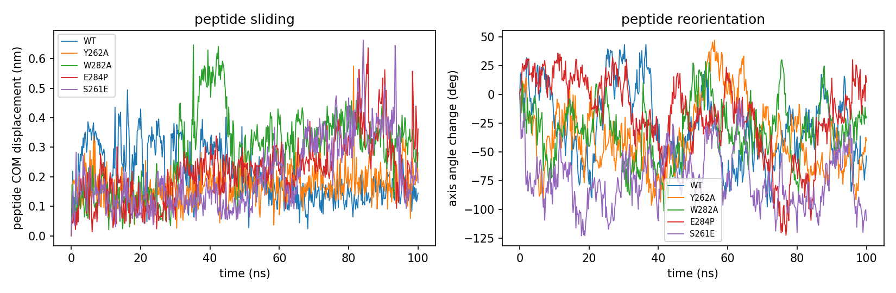
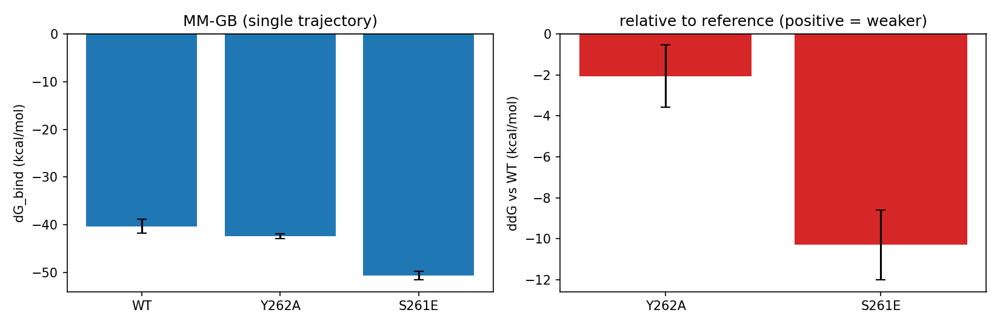

<div align="center">

# StructurePrep-Toolkit

**从晶体结构到可解释的 MD：蛋白–多肽/配体复合物的结构准备、模拟与界面分析流水线**

[](https://www.python.org/)
[](https://www.gromacs.org/)
[]()
[](LICENSE)

<p align="center">
  
  <br>
  <em>逐残基接触占时率：四个点突变都没有"减少"界面接触，而是让多肽沿结合沟槽重排</em>
</p>

</div>

---

## 目录

- [这是什么](#这是什么)
- [新闻与状态](#新闻与状态)
- [流水线总览](#流水线总览)
- [安装](#安装)
- [快速开始](#快速开始)
- [输出结构](#输出结构)
- [结果](#结果)
- [怎么读这些数字](#怎么读这些数字)
- [仓库结构](#仓库结构)
- [扩展到自己的体系](#扩展到自己的体系)
- [引用与许可](#引用与许可)

---

## 这是什么

本工具把「晶体结构 → 可运行的 MD 体系 → 可解释的界面指标」这条链路拆成 **5 个有明确通过判据的阶段**，
每一步都有对应的脚本、notebook 与判读依据，避免"跑完一堆模拟但不知道怎么下结论"。

针对的场景：**蛋白与多肽（含共价修饰，如生物素化赖氨酸）的界面**，也适用于小分子配体的常规 MD 准备。

---

## 新闻与状态

| 日期 | 内容 |
|---|---|
| 2026-11-27 | 新增 `contacts_agent.py`（逐残基接触 + 肽滑移）与 `mmpbsa_agent.py`（MM/GBSA），含配套 notebook |
| 2026-11-27 | 五变体（WT / Y262A / W282A / E284P / S261E）100 ns 全部完成并分析 |
| 2026-11-27 | **R279E 正在运行**（100 ns，预计当日完成），结果将并入下方表格 |
| 2026-11-26 | 仓库重构为流水线框架；移除结构文件与大体积视频；历史重建 |

> **数据政策**：本仓库**不包含**任何晶体结构、轨迹或拓扑文件。`data/` 为空占位，待论文发表后按 `data/README.md` 解禁。

---

## 流水线总览



| 阶段 | 入口 | 通过判据 |
|---|---|---|
| 01 结构准备 | `pipeline/01_prepare.sh` | 0 断点、0 缺原子、非标准残基清单明确 |
| 02 配体参数化 | `notebooks/ligand_param.ipynb` | 原子数、电荷和 = 净电荷、残基名一致 |
| 03 体系搭建 | `notebooks/MD_pipeline.ipynb` | `Total charge` 对账；水数×3 + 溶质 = gro 原子数 |
| 04 平衡与生产 | `pipeline/04_run.sh` | EM `Fmax<1000`；NVT ±5 K；NPT 密度 ≈1000 kg/m³ |
| 05 界面分析 | `scripts/analysis_agent.py` | 接触占时比、buried SASA、候选氢键、完整性排序 |

---

## 安装

```bash
# 推荐：conda / micromamba（CPU 版 GROMACS + AmberTools + ACPYPE）
micromamba create -p ./env -c conda-forge python=3.11 numpy pandas matplotlib \
    gromacs=2024.4 ambertools acpype openbabel
micromamba activate ./env

# 生产用：源码编译 CUDA 版（自动固定 AVX2 SIMD，避免换机器 Illegal instruction）
bash scripts/install_gromacs_cuda.sh
```

系统依赖：GROMACS ≥ 2021（实测 2024.4）、AmberTools（MM/PBSA、antechamber）、ACPYPE、OpenBabel。

---

## 快速开始

```bash
# 1) 建体系（EM → NVT → NPT → 生产）
python3 notebooks/MD_pipeline.ipynb      # 或 pipeline/01→04 逐段跑

# 2) 结构指标：一次算完所有变体并排序
python3 scripts/analysis_agent.py WT Y262A W282A --ref WT

# 3) 逐残基接触：判断"界面被破坏"还是"被重排"
python3 scripts/contacts_agent.py WT Y262A W282A --ref WT

# 4) MM/GBSA：给 ΔΔG 的方向
python3 scripts/mmpbsa_agent.py WT Y262A --ref WT
```

三类分析都是**幂等 + 可复用**：`--reuse` 会跳过已算过的步骤，秒级出表。

---

## 输出结构

```
ANALYSIS/
├── <V>/summary.csv              单变体全指标
├── <V>/figs/01–05*.png          稳定性/结合保持/距离/埋藏面积/氢键
├── <V>/contacts/                逐残基接触与肽滑移
├── comparison/                  多变体对比（metrics/ranking/figs）
├── contacts_compare.png         逐残基接触差
├── peptide_motion.png           肽滑移与取向
└── mmpbsa_summary.csv / bar.png MM-GBSA 汇总
```

---

## 结果

### 1. 界面完整性（0–50 ns，相对 WT 归一化）

<!-- RESULTS:START -->
| variant | window_ns | n_contacts_mean | candidate_hbonds_mean | buried_sasa_mean_nm2 | pep_rmsd_median_nm |
|---|---|---|---|---|---|
| WT | 50 | 480.0 | 9.28 | 10.62 | 0.463 |
| Y262A | 50 | 396.9 | 9.11 | 10.18 | 0.377 |
| W282A | 50 | 421.0 | 8.89 | 9.64 | 0.293 |
| E284P | 50 | 459.0 | 9.33 | 9.97 | 0.310 |
| S261E | 50 | 471.4 | 9.81 | 10.29 | 0.202 |
| R279E | 50 | *(running)* | — | — | — |
<!-- RESULTS:END -->

<p align="center">
  
  <br>
  <em>接触变化 / 候选氢键变化 / 界面完整性</em>
</p>

### 2. 界面重排（逐残基接触）

| 变体 | 总接触占时率 | 核心残基(>0.5) | 肽质心滑移 | 界面模式 |
|---|---|---|---|---|
| WT | 15.79 | 16 | 0.20 nm | 基准 |
| Y262A | 15.80 (+0.1%) | 16 | 0.17 nm | Pro286/Leu258 → Trp234/Ser230 |
| S261E | 15.05 (−4.7%) | 16 | 0.21 nm | Pro286/Leu258 → Pro264/Arg279 |
| W282A | 14.48 (−8.3%) | 13 | 0.29 nm | 重排 + 轻度减少 |
| E284P | 14.66 (−7.2%) | 13 | 0.22 nm | 重排 + 轻度减少 |
| R279E | *(running)* | — | — | — |

<p align="center">
  
  <br>
  <em>左：肽质心相对蛋白的滑移（已做叠合去整体漂移）；右：N端→C端向量转角（受内部柔性支配，仅作参考）</em>
</p>

### 3. MM/GBSA（单轨迹，GB igb=5，125 帧，50–100 ns）

| 变体 | ΔVDW | ΔEEL | ΔEGB | ΔESURF | ΔG_bind | ΔΔG vs WT |
|---|---|---|---|---|---|---|
| WT | −43.6 | −50.7 | +60.0 | −6.0 | −40.3 ± 1.5 | — |
| Y262A | −47.7 | −54.4 | +66.4 | −6.6 | −42.3 ± 0.5 | **−2.1 ± 1.5** |
| S261E | −46.9 | −141.3 | +144.4 | −6.8 | −50.6 ± 0.9 | −10.3 ± 1.7 |
| R279E | *(running)* | — | — | — | — | — |

（单位 kcal/mol，±SEM）

<p align="center">
  
</p>

> **注意**：ΔEEL 与 ΔEGB 必须成对引用。单轨迹 + 隐式溶剂 + 无熵项 → 只能比 ΔΔG 的方向，
> 绝对值（−40 kcal/mol）没有物理意义。详见 [`docs/metrics_guide.md`](docs/metrics_guide.md)。

### 4. 结构层面 vs 实验

| 层面 | 观察 | 说明 |
|---|---|---|
| 结构 | 四个突变体总接触变化 ≤8%，但逐残基 Σ\|Δ\| ≈ 3.6–4.1 | **重排**，不是破坏 |
| 能量 | Y262A ΔΔG = −2.1 kcal/mol（噪声内） | 结合姿态下相互作用能相当 |
| 实验 | ITC：Y262A 不结合 | **界面重排不足以解释**，更可能来自解离动力学/构象选择 |

**结论口径**：MD 说明"界面结构如何变化"，亲和力强弱由 ITC 判定；两者互补，不互相替代。
要拿到可与 ITC 对话的数值，需要伞形采样 PMF（ΔG_off）或 alchemical FEP（ΔΔG）。

---

## 怎么读这些数字

详见 [`docs/metrics_guide.md`](docs/metrics_guide.md)。三条最容易踩的边界：

1. **接触占时比 100% ≠ 结合强**：50 ns 看不到 ms 级的解离事件。
2. **结构指标分不出高低时，别继续换指标**：应转向能量学（MM/GBSA → PMF/FEP）。
3. **平均值会被周期性边界跳变污染**：肽位移必须用中位数，并记录剔除帧数。

---

## 仓库结构

```
├── data/                  ★ 默认不入库（晶体数据未发表，见 data/README.md）
├── docs/                  方法学与指标判读
├── pipeline/              五阶段入口脚本
├── notebooks/             MD_pipeline / ligand_param / Contacts / MMGBSA / MD_metrics*
├── scripts/               analysis_agent / contacts_agent / mmpbsa_agent / hbond_geometric / install_*
├── results/               汇总表与图（无原始数据）
└── legacy/                历史内容归档（FoldX/Rosetta 旧流程）
```

---

## 扩展到自己的体系

1. 把复合物 PDB 放到 `input/`，按 `notebooks/MD_pipeline.ipynb` 的 CONFIG 改变体名与配体 itp 路径
2. 配体参数化走 `notebooks/ligand_param.ipynb`（共价修饰肽要**整体参数化**，不能拆开）
3. 跑完把 `ANALYSIS/` 挂在 `scripts/analysis_agent.py` 与 `contacts_agent.py` 上即可得到同样的表与图

---

## 引用与许可

使用本流水线请注明来源。底层工具：GROMACS (Abraham et al., *SoftwareX* 2015)、
AmberTools、ACPYPE (Sousa da Silva & Vranken, *BMC Res. Notes* 2012)、OpenBabel。

License: [MIT](LICENSE)
