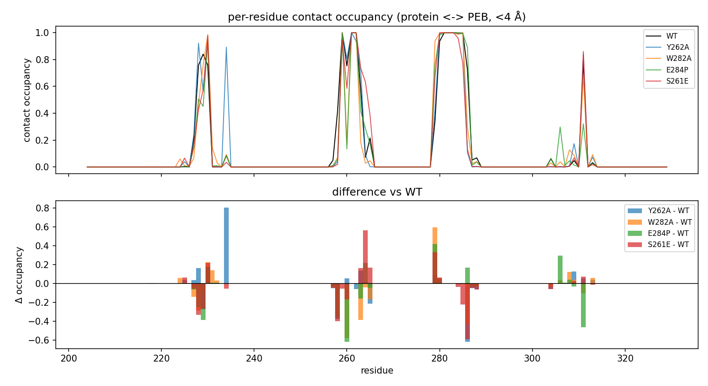
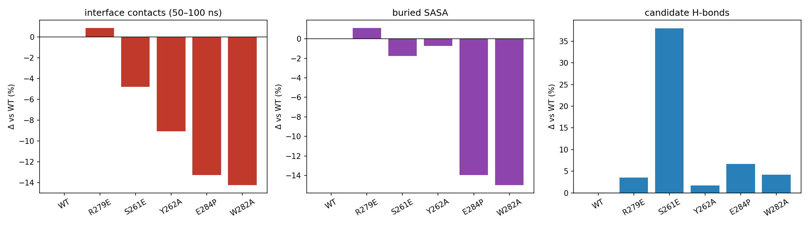
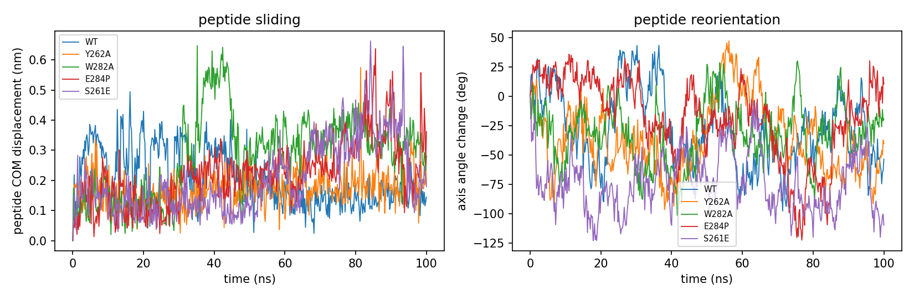
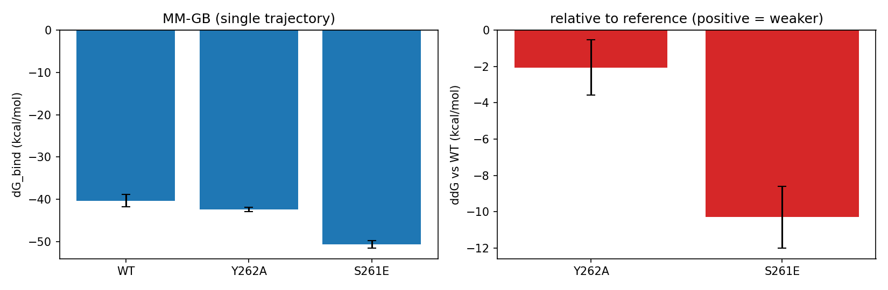
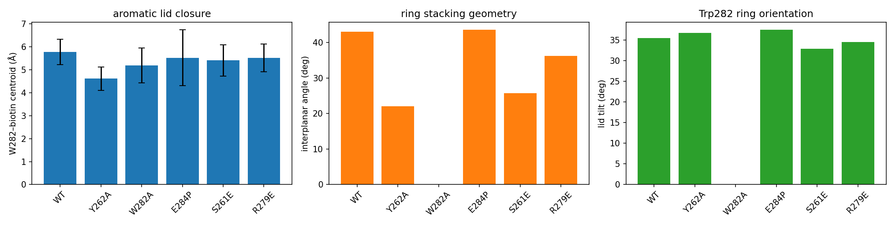

<div align="center">

# StructurePrep-Toolkit

**蛋白–多肽复合物的 MD 全流程工具：结构准备 → 参数化 → 模拟 → 界面分析 → 可解释的报告**

[](https://www.gromacs.org/)
[]()
[](https://www.python.org/)
[](LICENSING.md)

<p align="center">
  
  <br>
  <em>六个变体的逐残基接触占时率。四个点突变都没有"减少"界面接触，而是让多肽沿结合沟槽重排。</em>
</p>

</div>

---

## 它解决什么问题

做蛋白–多肽 MD，真正卡住人的往往不是 `gmx mdrun`，而是下面三件事：

1. **配体参数化**：共价修饰的肽（如生物素化赖氨酸）拆成"蛋白 + 小分子"就再也连不回去；ACPYPE 也不会替你猜键级。
2. **体系与环境的坑**：盒子选立方盒白装 40% 的水；换台机器 `gmx` 直接 `Illegal instruction`；`-nsteps` 续跑是累加而非绝对值。
3. **结果怎么读**：接触数掉了 17% 到底算"结合变弱"还是"换了个姿态"？MM/GBSA 给出 −2 kcal/mol 能不能写进论文？

本工具把这三件事拆成**有明确通过判据的阶段**，并且把"什么能说、什么不能说"写进文档，而不是留给你自己猜。

---

## 状态

| 项目 | 状态 |
|---|---|
| 六变体（WT / Y262A / W282A / E284P / S261E / R279E） | ✅ 各 100 ns 完成 |
| MM/GBSA | ✅ 六变体（125 帧/变体，50–100 ns） |
| 逐残基接触 / 芳香笼 / 逐残基分解 | ✅ 六变体 |
| 结构文件与轨迹 | ❌ **不在仓库内**（未发表数据，见 `data/README.md`） |

---

## 快速开始

```bash
# 环境（CPU 版够跑通；生产请看 scripts/install_gromacs_cuda.sh）
micromamba create -p ./env -c conda-forge python=3.11 numpy pandas matplotlib \
    gromacs=2024.4 ambertools acpype openbabel
micromamba activate ./env

# 建体系：EM → NVT → NPT → 生产
jupyter lab notebooks/MD_pipeline.ipynb

# 结构指标：一次算完所有变体并排序
python3 scripts/analysis_agent.py WT Y262A W282A --ref WT

# 逐残基接触：判断"破坏"还是"重排"
python3 scripts/contacts_agent.py WT Y262A W282A --ref WT

# MM/GBSA：给 ΔΔG 方向
python3 scripts/mmpbsa_agent.py WT Y262A --ref WT
```

三个分析脚本都是幂等的：`--reuse` 复用已有结果，秒级出表。

---

## 结果

> **窗口说明**：结构指标与 MM/GBSA 统一取 **50–100 ns**（平衡后窗口）；
> 逐残基接触与芳香笼几何取 **0–100 ns 全轨迹**（用于描述稳定的界面模式，不是能量比较）。

### 1 界面是否保持（50–100 ns，六个变体 n=6）

<!-- RESULTS:START -->
| variant | contacts | Δcontacts | H-bonds | ΔH-bonds | buried SASA (nm²) | ΔSASA | peptide shift (nm) |
|---|---|---|---|---|---|---|---|
| WT | 468.4 | — | 7.66 | — | 10.75 | — | 0.58 |
| R279E | 472.4 | +0.9% | 7.93 | +3.5% | 10.87 | +1.1% | 0.43 |
| S261E | 445.9 | −4.8% | 10.57 | +38.0% | 10.56 | −1.8% | 0.21 |
| Y262A | 425.8 | −9.1% | 7.79 | +1.7% | 10.67 | −0.7% | 0.33 |
| E284P | 406.2 | −13.3% | 8.17 | +6.7% | 9.25 | −13.9% | 0.86 |
| W282A | 401.7 | **−14.2%** | 7.98 | +4.2% | 9.14 | **−15.0%** | 0.84 |
<!-- RESULTS:END -->

<p align="center">
  
  <br>
  <em>50–100 ns 窗口：接触数、埋藏面积、候选氢键相对 WT 的变化</em>
</p>


- 所有变体的接触占时比均为 **100%**：50–100 ns 内没有解离事件
- 肽位移用**中位数**（周期性边界跳变会伪造 8–12 nm 的假峰，占总帧数 27–70%）
- H-bond 计数在突变体中反而略高——因为 WT 后半段氢键数下降（9.28 → 7.66），**该指标不具区分力**

### 2 界面是"被破坏"还是"被重排"（0–100 ns）

| 变体 | 总接触占时率 | 核心残基(>0.5) | 肽质心滑移 | 接触转移方向 |
|---|---|---|---|---|
| WT | 15.79 | 16 | 0.20 nm | — |
| Y262A | 15.80 (+0.1%) | 16 | 0.17 nm | Pro286/Leu258 → Trp234/Ser230 |
| R279E | 15.60 (−1.2%) | 16 | 0.22 nm | 变化最小（无残基 >15%） |
| S261E | 15.05 (−4.7%) | 16 | 0.21 nm | Pro286/Leu258 → Pro264/Arg279 |
| E284P | 14.66 (−7.2%) | 13 | 0.22 nm | 重排 + 轻度减少 |
| W282A | 14.48 (−8.3%) | 13 | 0.29 nm | 重排 + 轻度减少 |

<p align="center"></p>

**结论**：总量差异仅 0–8%，但逐残基差 Σ|Δ| ≈ 3.6–4.1，质心滑移 <0.3 nm
→ 变化是**界面内接触的重新分配**，不是肽跑掉。

### 3 MM/GBSA（单轨迹，GB igb=5，125 帧，50–100 ns）

| 变体 | ΔVDW | ΔEEL | ΔEGB | ΔESURF | ΔG_bind | ΔΔG vs WT |
|---|---|---|---|---|---|---|
| WT | −43.6 | −50.7 | +60.0 | −6.0 | −40.3 ± 1.5 | — |
| W282A | −31.7 | −46.5 | +56.6 | −4.2 | −25.8 ± 1.6 | **+14.5 ± 2.1** |
| Y262A | −47.7 | −54.4 | +66.4 | −6.6 | −42.3 ± 0.5 | −2.1 ± 1.5 |
| E284P | −45.1 | −48.3 | +58.3 | −5.9 | −40.9 ± 0.6 | −0.6 ± 1.6 |
| R279E | −53.4 | −63.8 | +78.8 | −7.0 | −45.4 ± 0.6 | −5.2 ± 1.6 |
| S261E | −46.9 | −141.3 | +144.4 | −6.8 | −50.6 ± 0.9 | −10.3 ± 1.7 |

<p align="center"></p>

- **只有 W282A 超出噪声**（|ΔΔG| > 3 kcal/mol），且 ΔVDW 少 11.9 kcal/mol——对应芳香笼盖子的丢失
- S261E 的 ΔEEL/ΔEGB 是其他变体的近 3 倍（−141/+144），属电荷-去溶剂化抵消，**不能读作变强**
- 逐残基分解（Amber MMPBSA.py）显示：W282A 合计 **+5.04**（几乎无补偿），
  S261E/R279E 合计 ≈ 0（削弱与补偿相消）

### 4 芳香笼几何（0–100 ns，501 帧/变体）

| 变体 | W282–生物素环心 | 环面夹角 | 解读 |
|---|---|---|---|
| WT | 5.78 ± 0.56 Å | 43° | edge-to-face 芳香笼 |
| Y262A | 4.62 ± 0.51 Å | 22° | 肽塞得更深、更平行 |
| S261E | 5.41 ± 0.69 Å | 26° | 同上 |
| W282A | 5.20 Å（CA 代替） | — | 笼子解散 |

<p align="center"></p>

### 5 结构、能量与实验的关系

| 层面 | 观察到 | 说明 |
|---|---|---|
| 结构 | 四个突变都是"重排"而非"坍塌" | 接触总量 0–8% 变化，位置换了 |
| 能量 | W282A 是唯一显著削弱（+14.5） | 与 ΔVDW、SASA、分解三证据一致 |
| 实验（ITC） | Y262A 不结合 | 结构重排不足以解释，需解离动力学 |

> 本流程能回答"界面结构如何变化"，**不回答"亲和力多强"**。要拿到可与 ITC 对话的数值，
> 需要伞形采样 PMF（ΔG_off）或 alchemical FEP（ΔΔG）；电荷突变尤其需要后者。

## 方法：五个阶段与通过判据

| 阶段 | 做什么 | 通过判据 | 入口 |
|---|---|---|---|
| 01 结构准备 | 拆链、去水、断点/缺原子检查、突变体建模 | 0 断点、0 缺原子、非标准残基清单明确 | `pipeline/01_prepare.sh` |
| 02 配体参数化 | GAFF2 + AM1-BCC；共价修饰肽**整体**参数化 | 原子数 / 电荷和 = 净电荷 / 残基名一致 | `notebooks/ligand_param.ipynb` |
| 03 体系搭建 | pdb2gmx → 拼 itp → 盒子 → 溶剂化 → 离子 | `Total charge` 对账；水数×3+溶质 = gro 原子数 | `notebooks/MD_pipeline.ipynb` |
| 04 平衡与生产 | EM → NVT(100 ps) → NPT(100 ps) → 100 ns | EM `Fmax<1000`；NVT ±5 K；NPT 密度 ≈1000 kg/m³ | `pipeline/04_run.sh` |
| 05 界面分析 | 结构指标 → 逐残基接触 → MM/GBSA | 见下节"三条判读边界" | `scripts/*_agent.py` |

**这类体系的默认选择**（都是实测对比后定的，不是照抄教程）：

| 项 | 默认 | 理由 |
|---|---|---|
| 盒子 | `-bt dodecahedron -d 1.1` | 同等最小镜像距离下比立方盒省 ~30% 水；**但跨变体比较必须用同一种盒子** |
| 力场 | `amber99sb-ildn` + `tip3p` | 与 GAFF2 的 comb-rule/fudge 匹配；GROMACS 2024.4 不带 amber14sb.ff |
| 离子 | `-neutral -conc 0.15` | 跨变体必须同浓度，否则静电屏蔽不可比 |
| 线程 | 按 `cgroup` 配额，不按 `nproc` | 容器里 `nproc` 常返回宿主核数（96 vs 12） |

---

## 三条判读边界（本项目踩过的坑）

1. **接触占时比 100% ≠ 结合强**
   五肽的 off-rate 对应 ms 级驻留，50 ns 短了 4–6 个数量级。看不到解离是必然的。

2. **结构指标分不出高低时，别继续换定义**
   Y262A 与 W282A 的界面完整性只差 0.8 个百分点——这已经是噪声，继续调阈值只是过拟合。

3. **平均值会被周期性边界跳变污染**
   肽位移出现 8–12 nm 尖峰的帧占 27–70%，必须用中位数；MM/GBSA 的轨迹还必须先 `-pbc nojump`
   （否则配体被成像到盒子另一侧，ΔG 直接变 ≈0）。

另外两个纯工程坑：
- `-nsteps` 在续跑时是**累加**：cpt 在 5,000,000 步时给 `-nsteps 25000000`，终点是 30,000,000。
- 编译时若不固定 `-DGMX_SIMD=AVX2_256`，换一台 CPU 就 `Illegal instruction`。

---

## 验证与自检清单

每个阶段跑完都该过一遍（`docs/` 里有详细版）：

- [ ] `gmx pdb2gmx` 打印的 `Total charge` 与手工估算一致（HIS 质子化态是常见偏差源）
- [ ] `solv.gro` 第二行原子数 = 溶质原子 + 3×水分子数
- [ ] EM 收敛且 `Maximum force < 1000 kJ/mol/nm`
- [ ] NVT 平均温度在 ±5 K 内；NPT 密度 1000 ± 10 kg/m³
- [ ] 轨迹的 `Last frame time` = 预期时长（**别拿 mdrun 末尾的 `Core t` 当模拟时间**）
- [ ] 分析前确认三个变体的**盒子 / 力场 / 时间窗口**一致

---

## 仓库结构

```
├── data/             ★ 空占位：晶体数据未发表，默认不入库（见 data/README.md）
├── docs/             方法学与指标判读（metrics_guide.md）
├── pipeline/         五阶段入口脚本
├── notebooks/        MD_pipeline / ligand_param / Contacts / MMGBSA
├── scripts/          analysis_agent / contacts_agent / mmpbsa_agent / hbond_geometric / install_*
├── results/          汇总表与图（不含原始数据）
└── legacy/           历史归档（FoldX/Rosetta 旧流程）
```

---

## 局限与不适用场景

- **不能预测亲和力**：普通 MD + MM/GBSA 只能给结构证据与 ΔΔG 方向。
- **强依赖起始结构**：起始姿态错，后面全错；建议先用对接/实验结构交叉验证。
- **隐式溶剂 MM/GBSA 对带电界面误差大**（±3–5 kcal/mol），绝对值不可引用。
- **短肽柔性大**：取向角这类指标受内部柔性支配，本项目实测 WT 自身涨落 ±35°。

---

## 许可与商业使用

本仓库为**评估版**：可自由用于学术研究与非商业验证。
**商业使用、二次分发、或以本工具提供服务需另行授权**——详见 [`LICENSING.md`](LICENSING.md)。

需要特别说明的**上游许可证约束**（与是否开源无关，属法律强制）：

| 依赖 | 许可证 | 对商业分发的影响 |
|---|---|---|
| GROMACS | LGPL-2.1 | 可动态链接分发，需保留许可证与源码获取方式 |
| AmberTools（antechamber/sqm/MMPBSA） | GPL | **不可**并入闭源产品；应要求用户自行安装 |
| ACPYPE / OpenBabel | GPL | 同上 |

因此本工具**不打包**上述 GPL 组件，只调用用户环境中的安装。

---

## 引用

使用本工具请注明来源。底层工具：
GROMACS（Abraham et al., *SoftwareX* 2015）、AmberTools、
ACPYPE（Sousa da Silva & Vranken, *BMC Res. Notes* 2012）、OpenBabel、PyMOL。
